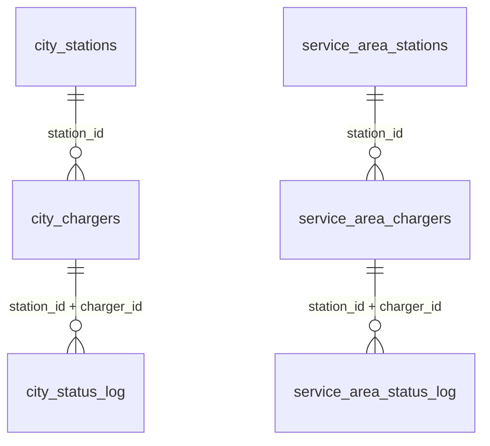

# 데이터베이스 구조

수집 데이터가 저장되는 PostgreSQL 16 DB의 테이블 · 컬럼 · 코드 정리. 원본 정의는 `backend/app/db/models.py`, 변경 이력은 `backend/migrations/`.

## 목차

- [개요](#개요)
- [테이블 관계](#테이블-관계)
- [테이블](#테이블)
- [코드표](#코드표)
- [수집 방식](#수집-방식)
- [데이터 사용 시 주의](#데이터-사용-시-주의)

---

## 개요

| 구분 | 테이블 | 범위 | 용도 |
|---|---|---|---|
| 도심 | `city_stations` · `city_chargers` · `city_status_log` | 서울 마포구 급속 69개소 · 190기 | 예측 · 추천 대상 (버스 전용 14기 제외 — [주의](#데이터-사용-시-주의)) |
| 휴게소 | `service_area_stations` · `service_area_chargers` · `service_area_status_log` | 천안 경부선 휴게소 4곳 · 9 statId · 27기 | 대조군 — **학습 · 추천 대상 아님** |

- 두 묶음은 컬럼이 같고, `service_area_stations`에만 `service_area_name` · `route` · `direction`이 더 있다.
- 테이블명에 지역명을 넣지 않음 — 수집 지역이 바뀌어도 스키마를 유지하기 위함.
- `alembic_version`은 마이그레이션 버전 관리용 (데이터 아님).

---

## 테이블 관계

충전기는 `(station_id, charger_id)` 두 컬럼으로 식별한다. `charger_id`만으로는 겹친다 (예: 여러 충전소에 `01`이 있음).

---

## 테이블

### `*_stations` — 충전소 (도심 69행 · 휴게소 9행)

| 컬럼 | 타입 | 설명 |
|---|---|---|
| `station_id` | varchar(20) PK | 충전소 ID (API `statId`). 앞 2글자는 운영기관 코드 |
| `name` | varchar(200) | 충전소명 (API `statNm`) |
| `addr` | varchar(300) | 주소 |
| `sido` · `gugun` | varchar(50) | 시도 · 군구 |
| `lat` · `lng` | double | 위도 · 경도 |
| `operator` | varchar(100) | 운영기관명 |
| `slow_charger_count` | int | 같은 충전소의 완속(≤11kW) 개수 — 화면 표시용, 수집 대상 아님 |
| `mid_charger_count` | int | 같은 충전소의 중속(11~50kW) 개수 — 화면 표시용, 수집 대상 아님 |
| `service_area_name` | varchar(50) | (휴게소만) 휴게소명 — 사업자마다 `name`이 달라 매핑으로 통일 |
| `route` | varchar(20) | (휴게소만) 노선 (`경부`) |
| `direction` | varchar(10) | (휴게소만) `상행` / `하행` |

### `*_chargers` — 충전기 (도심 190행 · 휴게소 27행)

| 컬럼 | 타입 | 설명 |
|---|---|---|
| `station_id` | varchar(20) PK · FK | 충전소 ID |
| `charger_id` | varchar(10) PK | 충전기 ID (API `chgerId`) |
| `charger_type` | varchar(50) | 충전기 타입 코드 (API `chgerType`) — [코드표](#chgertype--충전기-타입) |
| `capacity` | varchar(50) | 출력 kW (API `output`). **문자열**이므로 숫자로 변환해서 사용 |
| `is_limited` | boolean | 이용제한 여부 — 수집 단계에서 제한 충전기를 빼므로 항상 `false` |

### `*_status_log` — 상태 기록 (5분마다 충전기 전체 1행씩)

| 컬럼 | 타입 | 설명 |
|---|---|---|
| `id` | bigint PK | 일련번호 |
| `station_id` · `charger_id` | varchar FK | 충전기 |
| `stat` | varchar(5) | 충전기 상태 코드 — [코드표](#stat--충전기-상태) |
| `stat_upd_dt` | timestamptz | API가 준 상태 갱신 시각 (`statUpdDt`) — **상태 변경 시각으로 쓰지 말 것** (아래 주의 참고) |
| `last_charge_start_dt` | timestamptz | 마지막 충전 시작 (`lastTsdt`) |
| `last_charge_end_dt` | timestamptz | 마지막 충전 종료 (`lastTedt`) |
| `current_charge_start_dt` | timestamptz | 현재 충전 시작 (`nowTsdt`) — 충전중이 아니면 NULL |
| `collected_at` | timestamptz | 수집 시각 — 같은 회차의 행은 같은 분(minute) |

인덱스: `(station_id, charger_id, collected_at)` — 충전기별 시계열 조회용.

---

## 코드표

출처: 한국환경공단 전기자동차 충전소 정보 OpenAPI 활용가이드 v1.25

### `stat` — 충전기 상태

| 코드 | 의미 | 비고 |
|---|---|---|
| 0 | 알수없음 | 수집 데이터에 아직 없음 |
| 1 | 통신이상 | |
| 2 | 충전대기 | 사용 가능 |
| 3 | 충전중 | |
| 4 | 운영중지 | |
| 5 | 점검중 | |
| 6 | 예약중 | 수집 데이터에 아직 없음 |
| 9 | 상태미확인 | |

### `chgerType` — 충전기 타입

| 코드 | 의미 | 수집 대상에 있음 |
|---|---|---|
| 01 | DC차데모 | |
| 02 | AC완속 | |
| 03 | DC차데모+AC3상 | |
| 04 | DC콤보 | ✅ |
| 05 | DC차데모+DC콤보 | ✅ |
| 06 | DC차데모+AC3상+DC콤보 | ✅ |
| 07 | AC3상 | |
| 08 | DC콤보(완속) | |
| 09 | NACS | |
| 10 | DC콤보+NACS | ✅ (휴게소) |
| 11 | DC콤보2(버스전용) | ✅ (도심 14기 — 예측 · 추천 제외) |

---

## 수집 방식

- **대상 선정**: `getChargerInfo`를 지역코드(`zscode`)로 조회 → 출력 50kW 이상 · 삭제 제외 · 이용제한 제외. 도심은 마포구(`11440`), 휴게소는 천안(`44130`) 중 `backend/data/rest_area_mapping.csv`에 매핑한 statId만.
- **주기**: 5분마다 대상 충전기 전체를 한 회차로 저장 (도심 190행 + 휴게소 27행).
- **API**: 2026-10-03 19:16:03 KST부터 `getChargerStatus`(5분, 최근 변화분) + `getChargerInfo`(30분, 보정). 이전은 `getChargerInfo`만 사용 — [decisions.md](decisions.md) 참고.
- **시작**: 2026-09-23 15:09 KST.

---

## 데이터 사용 시 주의

- **시간대**: 모든 시각은 timestamptz(UTC 저장). 피처 생성 시 KST(`Asia/Seoul`)로 변환한다 (`BE-09`).
- **`stat_upd_dt`**: 운영사에 따라 상태가 그대로여도 계속 갱신되는 값이라 상태 변경 시각으로 쓸 수 없다. 충전 구간은 `last_charge_start_dt` · `last_charge_end_dt` · `current_charge_start_dt` 기준.
- **충전 시각 이상값**: 일부 운영사(ST 등)는 `last_charge_start_dt`가 갱신되지 않아 시작~종료가 수십~수백 시간으로 나온다. 세션 길이를 계산할 때는 상한을 두거나 `stat` 변화로 구간을 잡는다.
- **2026-09-23 ~ 2026-10-03 19:16 구간 `stat`**: 복원값 — [decisions.md](decisions.md) 2026-10-22 항목 참고.
- **휴게소 테이블은 대조군**이므로 학습 · 추천에 섞지 않는다.
- **상태가 불안정한 충전기**: 기후에너지환경부 14기(`ME19A245-21·22`, `ME19A246-21·22`, `ME19A265-22`, `ME19A601-23~26`, `ME21B180-01`, `ME21B412-01~04`)는 원천 데이터 문제로 30분마다 `2`↔`9`를 반복한다.
- **버스 전용 충전기**: `charger_type = '11'`인 도심 14기(`PK000186` 12기, `JA110208-01`, `JA110211-01`)는 버스 차고지 충전기라 **예측 · 추천 · 학습 대상에서 제외**한다(수집은 계속함 — [decisions.md](decisions.md) 2026-10-25 항목). 대상 충전기는 `city_chargers` 중 `charger_type <> '11'`인 66개소 · 176기.
