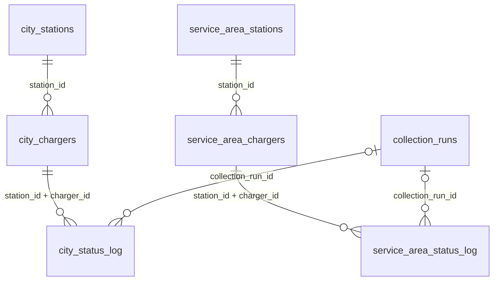

# 데이터베이스 구조

수집 데이터가 저장되는 PostgreSQL 16 DB의 테이블 · 컬럼 · 코드 정리. 원본 정의는 `backend/app/db/models.py`, 변경 이력은 `backend/migrations/`.

## 목차

- [개요](#개요)
- [테이블 관계](#테이블-관계)
- [테이블](#테이블)
- [ml 읽기 전용 뷰 (`ml_read`)](#ml-읽기-전용-뷰-ml_read)
- [ml 체크포인트 저장소 (`ml_checkpoint`)](#ml-체크포인트-저장소-ml_checkpoint)
- [코드표](#코드표)
- [수집 방식](#수집-방식)
- [데이터 사용 시 주의](#데이터-사용-시-주의)

---

## 개요

| 구분 | 테이블 | 범위 | 용도 |
|---|---|---|---|
| 도심 | `city_stations` · `city_chargers` · `city_status_log` | 서울 마포구 급속 69개소 · 190기 (버스 전용 14기는 2026-11-16부터 수집 안 함 → 66개소 · 176기) | 예측 · 추천 대상 (버스 전용 제외 — [주의](#데이터-사용-시-주의)) |
| 휴게소 | `service_area_stations` · `service_area_chargers` · `service_area_status_log` | 천안 경부선 휴게소 4곳 · 9 statId · 27기 | 대조군 — **학습 · 추천 대상 아님** |
| 서울 | `live_stations` · `live_chargers` · `live_status_log` | 서울(마포 제외) 급속 약 1,561곳 · 3,562기 (버스형 제외) | 지도 실시간 표시만 — **예측 · 학습 대상 아님** ([아래](#서울-live_--실시간-표시용)) |
| 공통 | `collection_runs` | 도심 · 휴게소 · 서울 수집 회차마다 1행 | 수집 성공 · 실패 · 결측 기록 (운영자 대시보드, 사용자 응답 `updatedAt`) |
| 운영자 | `admin_users` | 운영자 계정 (스크립트로만 생성) | 운영자 화면 로그인 — 다른 테이블과 관계 없음 |

- 세 묶음은 컬럼이 같고, `service_area_stations`에만 `service_area_name` · `route` · `direction`이 더 있다.
- 테이블명에 지역명을 넣지 않음 — 수집 지역이 바뀌어도 스키마를 유지하기 위함. 서울은 지역이 아니라 용도(`live_`, 실시간 표시)로 지음.
- `alembic_version`은 마이그레이션 버전 관리용 (데이터 아님).

---

## 테이블 관계

충전기는 `(station_id, charger_id)` 두 컬럼으로 식별한다. `charger_id`만으로는 겹친다 (예: 여러 충전소에 `01`이 있음).

---

## 테이블

### `*_stations` — 충전소 (도심 69행 · 휴게소 9행)

| 컬럼 | 타입 | 설명 |
|---|---|---|
| `station_id` | varchar(20) PK | 충전소 ID (API `statId`). 앞 2글자는 운영기관 코드 |
| `name` | varchar(200) | 충전소명 (API `statNm`) |
| `addr` | varchar(300) | 주소 |
| `sido` · `gugun` | varchar(50) | 시도 · 군구 |
| `lat` · `lng` | double | 위도 · 경도 |
| `operator` | varchar(100) | 운영기관명 |
| `slow_charger_count` | int | 같은 충전소의 완속(≤11kW) 개수 — 화면 표시용, 수집 대상 아님 |
| `mid_charger_count` | int | 같은 충전소의 중속(11~50kW) 개수 — 화면 표시용, 수집 대상 아님 |
| `service_area_name` | varchar(50) | (휴게소만) 휴게소명 — 사업자마다 `name`이 달라 매핑으로 통일 |
| `route` | varchar(20) | (휴게소만) 노선 (`경부`) |
| `direction` | varchar(10) | (휴게소만) `상행` / `하행` |

### `*_chargers` — 충전기 (도심 190행 · 휴게소 27행)

| 컬럼 | 타입 | 설명 |
|---|---|---|
| `station_id` | varchar(20) PK · FK | 충전소 ID |
| `charger_id` | varchar(10) PK | 충전기 ID (API `chgerId`) |
| `charger_type` | varchar(50) | 충전기 타입 코드 (API `chgerType`) — [코드표](#chgertype--충전기-타입) |
| `capacity` | varchar(50) | 출력 kW (API `output`). **문자열**이므로 숫자로 변환해서 사용 |
| `is_limited` | boolean | 이용제한 여부 — 수집 단계에서 제한 충전기를 빼므로 항상 `false` |

### `*_status_log` — 상태 기록 (5분마다 충전기 전체 1행씩)

| 컬럼 | 타입 | 설명 |
|---|---|---|
| `id` | bigint PK | 일련번호 |
| `station_id` · `charger_id` | varchar FK | 충전기 |
| `stat` | varchar(5) | 충전기 상태 코드 — [코드표](#stat--충전기-상태) |
| `stat_upd_dt` | timestamptz | API가 준 상태 갱신 시각 (`statUpdDt`) — **상태 변경 시각으로 쓰지 말 것** (아래 주의 참고) |
| `last_charge_start_dt` | timestamptz | 마지막 충전 시작 (`lastTsdt`) |
| `last_charge_end_dt` | timestamptz | 마지막 충전 종료 (`lastTedt`) |
| `current_charge_start_dt` | timestamptz | 현재 충전 시작 (`nowTsdt`) — 충전중이 아니면 NULL |
| `collected_at` | timestamptz | 수집 시각 — 같은 회차의 행은 같은 분(minute) |
| `collection_run_id` | int FK · NULL 허용 | 이 행을 저장한 수집 실행 (`collection_runs.id`). `collection_runs` 도입 이전 행은 소급으로 채움 |

인덱스: `(station_id, charger_id, collected_at)` — 충전기별 시계열 조회용. 도심만 `(collection_run_id, id)` — `ml_read.collection_runs` 뷰의 회차별 판정용, `(collected_at, id)` — ml 회차 검증(기점 ~ cutoff 중 마지막 행)용. 충전기별 인덱스로는 이력 전체를 읽어 서버에서 27~30초 걸림(2026-11-18, 276만 행).

### `collection_runs` — 수집 실행 이력 (지역별 5분마다 1행)

| 컬럼 | 타입 | 설명 |
|---|---|---|
| `id` | int PK | 일련번호 |
| `target` | varchar(20) | `city` · `service_area` · `live` — 상태 로그 테이블 접두어 |
| `zscode` | varchar(50) | 조회 지역 코드 (`11440` · `44130`, 서울은 시도 코드 `zcode` `11`) |
| `started_at` | timestamptz | 수집 시작 시각. 소급 행은 그 회차의 `collected_at` |
| `finished_at` | timestamptz | 수집 종료 시각 — 실행 중이거나 소급 행, 시작 때 정리한 중단 회차(아래 `FAILED`)면 NULL |
| `status` | varchar(10) | `RUNNING` · `SUCCESS` · `PARTIAL` · `FAILED` (아래 표) |
| `api_latency_ms` | int | `getChargerStatus` 응답 지연 — 소급 행은 NULL |
| `expected_count` | int | 수집 대상 충전기 수 |
| `matched_count` | int | 상태 로그에 저장한 충전기 수. **결측 = `expected_count − matched_count`** |
| `eligible_expected_count` | int · NULL 허용 | 서비스 대상(버스전용 제외) 충전기 수 — 운영자 결측 현황 기준. 2026-11-16 collector 이전 도심 회차는 위 두 값에 버스전용 14기가 섞여 있음 (이후는 수집 대상에서 빼서 같은 값) |
| `eligible_matched_count` | int · NULL 허용 | 그중 상태 로그에 저장한 수 (`FAILED`는 0). 두 컬럼 도입(2026-11-16) 이전 회차는 `scripts/backfill_eligible_counts.py`로 채움 — 채우기 전에는 NULL |
| `error_message` | text | 실패 내용 (엔드포인트 · 지역 · HTTP 코드) — 소급 행은 NULL |
| `is_backfilled` | boolean | 기존 상태 로그로 만든 소급 행 — 실제 호출 기록이 아님 |

| `status` | 조건 | 상태 로그 |
|---|---|---|
| `RUNNING` | 수집 중. 프로세스가 도중에 멈춰 남은 회차는 collector가 다음에 시작할 때 `FAILED`로 바꿈 (2026-11-17) | — |
| `SUCCESS` | Status 성공, (Info 회차면) Info 성공, 대상 전부 저장 | 저장 |
| `PARTIAL` | Status 성공, Info 보정 실패 또는 상태를 모르는 충전기 있음 | 저장 |
| `FAILED` | Status 호출 실패 또는 DB 저장 오류, 또는 끝내지 못한 회차(`error_message` "수집 중단 …", `finished_at` NULL) | **저장 안 함** |

인덱스: `(target, started_at)`.

### 서울 `live_*` — 실시간 표시용

서울(마포 제외) 급속 충전기를 마포와 **같은 방식(5분 스냅샷)** 으로 수집한다. 지도에 실시간 상태만 보여 주고 예측 · 추천 · 학습에는 쓰지 않는다. 마이그레이션 `8642c296d6ff`.

- 컬럼은 `city_*`와 같다 (`live_status_log` 인덱스는 `(station_id, charger_id, collected_at)` + `(collection_run_id)`). 나중에 서울도 예측하게 되면 `INSERT ... SELECT`로 합치거나 `UNION ALL`로 함께 읽을 수 있다 — 마포를 빼고 수집하므로 충전기가 겹치지 않음
- 대상: `getChargerInfo(zcode=11)` 중 삭제 제외 · 50kW 이상 · 이용제한 없음 · **버스형 제외** · **마포(`zscode` `11440`) 제외** — 마포 목록과 같은 기준. `scripts/init_live_chargers.py`로 한 번 채우고 고정해서 씀 (목록 갱신은 데모 후). 2026-11-16 로컬 실측 3,562기 · 1,561곳
  - 원천 데이터 오류도 뺌 (2026-11-16): 이름에 "테스트"가 든 충전소(GS칼텍스 시험 등록 2곳 — 좌표 33.0, 125.0), 좌표가 서울 경계에서 1km 넘게 밖인 충전소(주소와 좌표가 다른 4곳 — 6 · 26 · 31 · 33km 밖). 경계는 프론트 지도 범위(`coverage-boundary.json`)의 서울 경계를 복사한 `scripts/seoul_boundary.json`. "운전면허시험장"처럼 "시험"은 실제 충전소라 빼지 않음. 버스 이름이어도 타입이 `11`이 아니면 그대로 둠
  - 이미 채운 대상에는 `--prune`(목록) → `--prune --commit`(그 충전소의 상태 로그 · 충전기 · 충전소 삭제)으로 같은 규칙을 적용. collector는 회차마다 대상을 DB에서 읽어 재시작 없이 빠짐
- `live_stations`의 완속 · 중속 개수는 같은 Info에서 셈 (`update_charger_counts.py`와 같은 기준)
- 회차는 `collection_runs.target = 'live'`. 서울 Info는 약 8페이지라 페이지당 재시도 2회 · 전체 3분 상한
- 용량: 회차당 약 3,562행 → 하루 약 103만 행 · **약 340MB** (행당 약 333B, 로컬 실측). 지금은 보존 기간 없음 — 디스크를 보며 정함. 일일 백업(`pg_dump -Fc`)은 반복 값이 많아 DB 크기의 약 2%라 부담 작음

### `admin_users` — 운영자 계정

| 컬럼 | 타입 | 설명 |
|---|---|---|
| `id` | int PK | 일련번호 |
| `login_id` | varchar(50) UNIQUE | 로그인 아이디 (요청 `loginId`) — 대소문자 구분 |
| `password_hash` | varchar(255) | argon2id 해시 (PHC 문자열 — 알고리즘 · 설정값 · salt 포함) |
| `name` | varchar(50) | 표시 이름 (응답 `admin.name`) |
| `created_at` | timestamptz | 계정 생성 시각 |
| `password_changed_at` | timestamptz | 마지막 비밀번호 설정 시각 — 이보다 먼저 발급된 토큰(`iat`)은 거부 |
| `last_login_at` | timestamptz | 마지막 로그인 성공 시각 — 로그인한 적 없으면 NULL |

- 계정 생성 · 비밀번호 변경은 `backend/scripts/create_admin.py`로만 한다 (운영자 화면에 가입 · 변경 기능 없음). 서버에서는 `docker compose exec api python scripts/create_admin.py <login_id> [--name <이름>]`
- 로그인 실패 횟수는 Redis(`login_fail:{login_id}`)에 TTL로 두므로 잠금 컬럼이 없다.
- 계정을 막으려면 행을 지운다 — 운영자 API가 요청마다 계정을 조회하므로(로그인 API 구현 시) 남은 토큰도 바로 거부된다.

---

## ml 읽기 전용 뷰 (`ml_read`)

AI 추천 모듈(ml 컨테이너)이 읽는 뷰. 원본 테이블 대신 이 뷰만 읽는다. 마이그레이션 `e75d10ca4bb2`(생성) · `bf1eb7afd713`(이력 기점 9/23).

- 스키마 `ml_read` — `public`에 형식이 다른 `collection_runs` 테이블이 있어 분리. ml은 `EVFLOW_POSTGRES_SCHEMA=ml_read`
- 읽기 역할 `evflow_ml_reader` — `ml_read` 조회 권한만 있음(원본 테이블 직접 조회 불가), 기본 읽기 전용 트랜잭션.
  마이그레이션은 NOLOGIN으로만 만들고, 로그인 · 비밀번호는 서버에서 직접 설정 (`\password evflow_ml_reader` → `ALTER ROLE evflow_ml_reader LOGIN`).
  DSN은 서버 `.env`(`EVFLOW_ML_READONLY_DSN`, 호스트 `postgres:5432`)에만 둔다. compose가 ml에 이 값과 `EVFLOW_POSTGRES_SCHEMA`만 넘기고 `.env` 전체는 넘기지 않음
- 범위: **도심(마포)만**, **버스전용(`charger_type = '11'`) 제외**, **첫 관측(2026-09-23 06:09:27.818124 UTC = 15:09 KST)부터**
  - 전환 이전(~2026-10-03 19:16:03 KST) 행은 2026-10-22 `restore_pre_switch.py`로 `stat`을 복원값으로 바꾼 행이라 AI 학습 데이터와 같음 (11/18 서버 확인: 515,680행 · AI 측정값과 일치)
  - 기점은 AI 체크포인트에 바인딩됨 → 바꾸면 체크포인트 전체 재구축 + AI 팀 공지. ml은 체크포인트 + 최근 원시 로그만 읽고 전체 이력을 한 번에 읽지 않음
- `inventory_version` = 고정값 `city_20260923` — 충전기 목록을 바꾸면 새 마이그레이션으로 값을 올리고 AI 팀에 공지

### `ml_read.collection_runs` — 도심 수집 회차 (`target = 'city'`만)

| 컬럼 | 만드는 방법 |
|---|---|
| `run_id` | `collection_runs.id` |
| `target` · `status` · `started_at` · `finished_at` · `is_backfilled` | 원본 그대로 |
| `committed_at` | `SUCCESS` · `PARTIAL`이면 `finished_at`, 아니면 NULL — 로그와 회차 결과를 한 트랜잭션으로 커밋하므로 같은 값. 소급 회차는 `finished_at`이 없어 NULL |
| `evidence_cutoff_at` | 그 회차 로그의 `collected_at` (한 회차는 한 값) — 로그가 없으면 NULL |
| `max_status_pk` | 그 회차 로그의 최대 `id` — 회차 순서와 id 순서가 같음 |
| `failed_without_rows` | `FAILED`이면서 그 회차 로그가 실제로 없음 — 소급 `FAILED`(10/7~11/1)는 로그가 있어 `false` |
| `history_start_at` | 고정 `2026-09-23 06:09:27.818124+00` (도심 첫 관측) |
| `history_complete` | `true` |
| `inventory_version` | 고정값 |

### `ml_read.stations` · `ml_read.chargers` (66곳 · 176기)

- `stations`: `city_stations` 열 전부 + `data_region = 'city'` · `inventory_version`. 버스전용만 있는 충전소 제외
- `chargers`: `city_chargers` 열 전부 + `capacity_kw`(`capacity`를 숫자로) · `data_region` · `inventory_version`

### `ml_read.status_logs`

| 컬럼 | 만드는 방법 |
|---|---|
| `source_log_id` · `status_pk` | `city_status_log.id` |
| `station_id` · `charger_id` · `stat` · 시각 5개 | 원본 그대로 (`current_charge_start_dt`도 원본 — 충전 중이 아닐 때 값이 있으면 모듈이 무시) |
| `charging_elapsed_minutes` | `stat = '3'`이고 시작 시각 ≤ 수집 시각일 때 (수집 시각 − 충전 시작) 분, 아니면 NULL |
| `is_restored` | `collected_at < 2026-10-03 10:16:03+00` (전환 이전 복원 행, `export_dataset.py`와 같은 기준 · 정확히 경계인 행은 `false`) |
| `collection_run_id` · `collection_status` · `is_failed_cycle` | 회차 id · 회차 `status` · 회차가 `FAILED`인지 |
| `data_region` · `inventory_version` | `'city'` · 고정값 |

로컬 측정 (서버 복사본 10/3~10/24, 108만 행): 모듈 `load_run` 5.4초 · 프로세스 최대 메모리 약 900MB — 전체 이력을 한 번에 읽으면 이력 범위가 메모리를 좌우함. 서버는 9/23부터라 더 크므로(11/17 기준 약 271만 행) 전체 이력 모드로 읽지 않음

---

## ml 체크포인트 저장소 (`ml_checkpoint`)

AI 추천 모듈의 대기 예측이 과거 이력을 매번 읽지 않도록, 기점부터 회차 직전까지의 요약 상태를 회차마다 게시해 두는 곳. ml은 요청한 회차의 체크포인트 0 ~ 1행 + 최근 원시 로그(약 70분)만 읽는다. 마이그레이션 `7c5eec7b9ab4` — AI v3.1 `sql/001_checkpoint_store.sql` · `003_role_grants.sql`을 그대로 옮김.

- 원천 뷰(`ml_read`)와 스키마를 분리함 — 뷰를 다시 만드는 마이그레이션과 섞이지 않게
- 체크포인트는 원천에서 언제든 다시 만들 수 있음 (최초 구축 약 3.5분, 2026-11-17 AI 실측)
- 회차마다 게시 · 최초 구축 · 재구축은 producer가 맡음 — [prediction.md 체크포인트 producer](prediction.md#체크포인트-producer)

| 표 · 함수 | 내용 |
|---|---|
| `history_checkpoints` | 회차별 체크포인트 9열 — `checkpoint_key`(= `run_id` 문자열) · `run_id` · `boundary_at`(요약/최근 로그 경계) · `content_sha256` · `payload`(jsonb) · `source_revision` · `max_status_pk` · `is_valid` · `published_at` |
| `history_source_revision` | 한 행(`singleton = 1`)의 `revision` — 시작값 0. 체크포인트는 같은 revision일 때만 유효 |
| `history_revision_events` | revision을 올린 기록 (언제부터 영향 · 사유 · 계정) |
| `lock_source_revision()` | 게시 중 revision 공유 잠금 — 게시와 정정이 엇갈리지 않게 |
| `invalidate_history(changed_from, reason)` | 과거 원천을 고칠 때 **같은 트랜잭션에서** 호출 → revision +1 · 모든 체크포인트 무효 · 기록 |

`invalidate_history`를 호출하는 곳:
- collector 시작 시 남은 `RUNNING` 정리(`close_orphaned_runs`) — 도심 회차가 1건 이상 바뀌면 그중 가장 이른 `started_at`으로 호출. 함수가 없으면(마이그레이션 전) 건너뜀
- 과거 상태 로그 · 회차를 고치는 스크립트를 새로 만들면 같은 방식으로 호출해야 함
- 충전기 목록(`inventory_version`)을 바꿀 때는 호출하지 않고 새 버전으로 체크포인트를 새로 구축

역할 (모두 NOLOGIN으로 만듦 — 로그인 · 비밀번호는 서버에서 직접, `evflow_ml_reader`와 같은 방식)

| 역할 | 권한 | 쓰는 곳 |
|---|---|---|
| `evflow_ckpt_reader` | `ml_read` 뷰 4개 · `history_source_revision` 읽기, 기본 읽기 전용 트랜잭션 | producer 계산 |
| `evflow_ckpt_writer` | `history_checkpoints` 읽기 · INSERT · UPDATE, `history_source_revision` 읽기, `lock_source_revision()` 실행 | producer 게시 |
| `evflow_ml_reader` | 기존 `ml_read` + `history_checkpoints` · `history_source_revision` 읽기 (쓰기 권한이 있으면 모듈이 시작을 거부함) | ml 서빙 |
| `evflow` (소유자) | 전부 — `invalidate_history` 실행 포함 | collector |

---

## 코드표

출처: 한국환경공단 전기자동차 충전소 정보 OpenAPI 활용가이드 v1.25

### `stat` — 충전기 상태

| 코드 | 의미 | 비고 |
|---|---|---|
| 0 | 알수없음 | 수집 데이터에 아직 없음 |
| 1 | 통신이상 | |
| 2 | 충전대기 | 사용 가능 |
| 3 | 충전중 | |
| 4 | 운영중지 | |
| 5 | 점검중 | |
| 6 | 예약중 | 수집 데이터에 아직 없음 |
| 9 | 상태미확인 | |

### `chgerType` — 충전기 타입

| 코드 | 의미 | 수집 대상에 있음 |
|---|---|---|
| 01 | DC차데모 | |
| 02 | AC완속 | |
| 03 | DC차데모+AC3상 | |
| 04 | DC콤보 | ✅ |
| 05 | DC차데모+DC콤보 | ✅ |
| 06 | DC차데모+AC3상+DC콤보 | ✅ |
| 07 | AC3상 | |
| 08 | DC콤보(완속) | |
| 09 | NACS | |
| 10 | DC콤보+NACS | ✅ (휴게소) |
| 11 | DC콤보2(버스전용) | ✅ (도심 14기 — 예측 · 추천 제외) |

---

## 수집 방식

- **대상 선정**: `getChargerInfo`를 지역코드(`zscode`)로 조회 → 출력 50kW 이상 · 삭제 제외 · 이용제한 제외. 도심은 마포구(`11440`), 휴게소는 천안(`44130`) 중 `backend/data/rest_area_mapping.csv`에 매핑한 statId만.
- **주기**: 5분마다 대상 충전기 전체를 한 회차로 저장 (도심 190행 + 휴게소 27행).
- **실패 처리**: 회차마다 `collection_runs`에 1행. `getChargerStatus` 호출이 실패하면 `FAILED`로 남기고 그 회차 상태 로그는 쓰지 않는다 — 다음 회차 `period=10`이 빠진 구간의 변화를 받아옴 (UC-S01 E1 · ECR-004). 성공한 회차에서 응답에 없는 충전기는 "변화 없음"이라 직전 상태를 이어 쓴다.
- **API**: 2026-10-03 19:16:03 KST부터 `getChargerStatus`(5분, 최근 변화분) + `getChargerInfo`(30분, 보정). 이전은 `getChargerInfo`만 사용 — [decisions.md](decisions.md) 참고.
- **시작**: 2026-09-23 15:09 KST.

---

## 데이터 사용 시 주의

- **시간대**: 모든 시각은 timestamptz(UTC 저장). 피처 생성 시 KST(`Asia/Seoul`)로 변환한다 (`BE-09`).
- **`stat_upd_dt`**: 운영사에 따라 상태가 그대로여도 계속 갱신되는 값이라 상태 변경 시각으로 쓸 수 없다. 충전 구간은 `last_charge_start_dt` · `last_charge_end_dt` · `current_charge_start_dt` 기준.
- **충전 시각 이상값**: 일부 운영사(ST 등)는 `last_charge_start_dt`가 갱신되지 않아 시작~종료가 수십~수백 시간으로 나온다. 세션 길이를 계산할 때는 상한을 두거나 `stat` 변화로 구간을 잡는다.
- **2026-09-23 ~ 2026-10-03 19:16 구간 `stat`**: 복원값 — [decisions.md](decisions.md) 2026-10-22 항목 참고.
- **휴게소 테이블은 대조군**이므로 학습 · 추천에 섞지 않는다.
- **상태가 불안정한 충전기**: 기후에너지환경부 6개소 17기(`ME19A245-21·22`, `ME19A246-21·22`, `ME19A265-21·22`, `ME19A601-21~26`, `ME21B180-01`, `ME21B412-01~04`)는 원천 데이터 문제로 30분마다 `2`↔`9`를 반복한다. 그 사이에도 충전 세션이 있어 고장으로 보지 않는다. `ME19A265-21` · `ME19A601-21·22`는 2026-11-07 추가 — 2026-10-08 ~ 11-07 `2`↔`9` 전환 481 · 289 · 289회 (기존 14기 669 ~ 1,346회, 나머지 충전기 최대 67회). 목록은 `backend/app/services/status.py`의 `UNSTABLE_CHARGERS` 한 곳에서 관리 — API 응답 `unstable`과 추출본 `data_flag`가 같이 씀
- **버스 전용 충전기**: `charger_type = '11'`인 도심 14기(`PK000186` 12기, `JA110208-01`, `JA110211-01`)는 버스 차고지 충전기라 **예측 · 추천 · 학습 대상에서 제외**한다. 2026-10-25 ~ 11-16에는 수집은 계속했고, **2026-11-16 collector부터는 수집도 하지 않는다** — 그 뒤로 이 14기의 로그가 없다 ([decisions.md](decisions.md) 2026-11-16 항목). 충전기 행 · 지난 로그는 남겨 둠. 대상 충전기는 `city_chargers` 중 `charger_type <> '11'`인 66개소 · 176기.
- **결측 회차 (`collection_runs` 도입 이후)**: Status 호출이 실패한 회차는 상태 로그가 없어 5분 격자에 빈칸이 생긴다. 빈칸이 결측인지는 `collection_runs.status = 'FAILED'`로 확인한다. 도입 시점은 `is_backfilled = false`인 첫 행의 `started_at`.
- **결측 회차 (그 이전, 소급 추정)**: 이전 collector는 Status 호출이 실패해도 직전 상태를 새 `collected_at`으로 저장했다. 소급 스크립트(`scripts/backfill_collection_runs.py`)가 전환 이후 회차 중 `max(stat_upd_dt)`가 직전 회차보다 늘지 않은 회차를 실패로 추정해 `FAILED` · `is_backfilled = true` · `matched_count = 0`으로 표시했다. 그 회차의 행은 남아 있고 `collection_run_id`로 연결된다 (추출본 `is_failed_cycle = true`). 전환 이전 회차는 추정할 수 없어 모두 `SUCCESS`로 두었다.
  - 결과 (2026-11-01 17:41 KST까지): 전환 이후 8,334회차 중 도심 748회차(9.0%) · 휴게소 780회차(9.4%). **10/7 2회를 빼면 전부 10/23 이후** — 공공 API 응답이 10초 타임아웃을 넘긴 것(`ReadTimeout`)이 원인 ([decisions.md](decisions.md) 2026-11-01)
  - collector 로그(10/3 19:16 ~ 11/1 17:31)와 대조: 두 지역 모두 **정밀도 0.94 · 재현율 0.96**
  - 놓친 실패는 대부분 Status 실패 + 같은 회차 Info 보정 성공 — 그 행은 직전 상태가 아니라 Info 값(최대 30분 지연)이다
  - 로그에 실패가 없는데 `FAILED`로 잡힌 회차(도심 42 · 휴게소 45)는 API가 새 값 없이 응답한 회차라 데이터로는 실패와 같다
